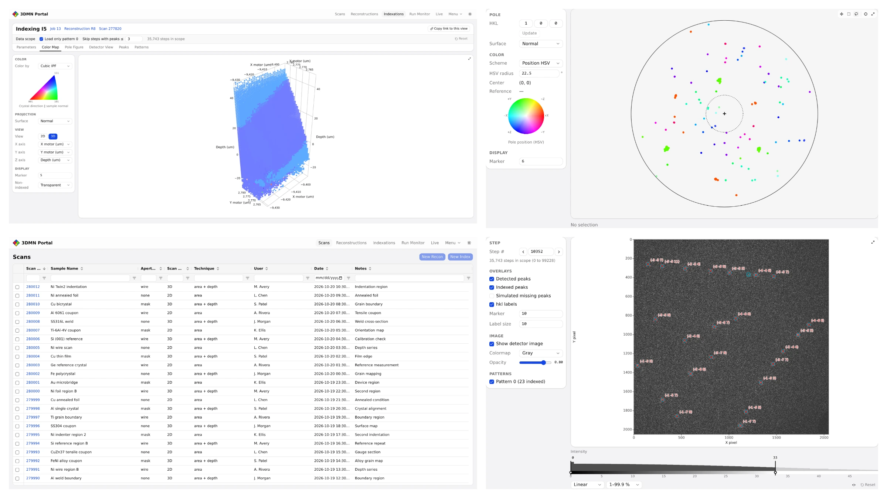

# Laue Portal

Web portal for Laue diffraction analysis at APS beamline 34-ID-E. Users import scans, reconstruct wire scans, index
frames with LaueGo and inspect the results in the browser, and run the computation on the portal host, on the APS
cluster or at ALCF. [lauelab](https://github.com/advancedphotonsource/lauelab) does the scientific computation.

When ALCF is enabled, the navbar's status indicator shows read-only checks of DM, Globus, storage access and the
Crux endpoint; its panel shows the last check and a refresh action. See the
[remote deployment runbook](docs/runbooks/remote-execution.md#connectivity-monitor).



The [user guide](docs/user/workflows.md) describes the workflows, and the [deploy runbook](docs/runbooks/deploy.md)
describes how to install and operate the portal. Laue Portal replaces the earlier, Dash-based portal, now archived at
[laue-portal-archive](https://github.com/advancedphotonsource/laue-portal-archive); step 4 of the deploy runbook
migrates its database. [`AGENTS.md`](AGENTS.md) contains the rules for changing the code.

## Develop

The portal builds on Linux x86-64. It needs `git`, `curl`, `uv` and Node 26
([prerequisites](docs/runbooks/dev-setup.md#prerequisites)); `make setup` installs the rest into `.workspace/`. All
development data is synthetic.

```bash
git clone https://github.com/advancedphotonsource/laueportal.git
cd laueportal
make setup     # the conda-forge environment, lauelab and the frontend's packages
make dev-up    # the portal on http://127.0.0.1:2100, with a demo database
make dev-down
```

## Test

```bash
make check               # the fast checks; CI runs them on every push and pull request
make test-slow           # native computation and the slower tests
make test-frontend-slow  # the heaviest page tests, which make check leaves out
make e2e                 # the browser tests (Playwright, Chromium)
```

`make help` lists the other targets.

## License

See [LICENSE](LICENSE).
