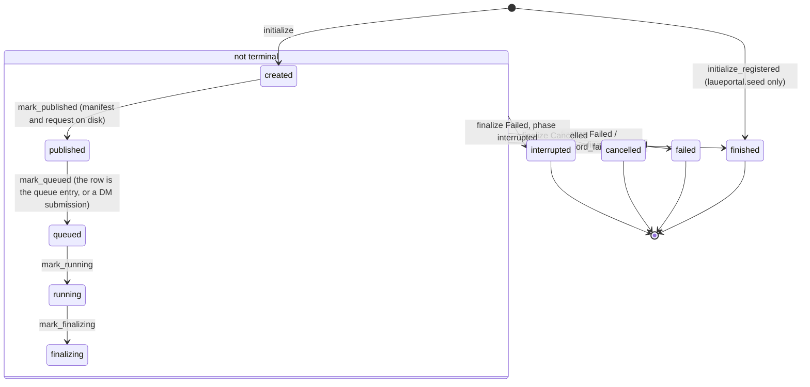

# Architecture

How the portal's code fits together. The rules for changing it are in [`AGENTS.md`](../AGENTS.md) and
[`contributing/`](contributing/); the run directory's files are described in `backend/src/laueportal/jobs/rundir.py`
and pinned by the goldens in `backend/tests/fixtures/remote_goldens/`.

## Processes

| Program | Command | Listens on | Role |
|---|---|---|---|
| `api` | `laueportal serve` (`--reload` in dev) | 127.0.0.1 (dev 2100) | One uvicorn process: `/api/v1` and the built SPA (`app.static_dir`; client routes fall back to `index.html`). |
| `worker` | `laueportal worker` | — | One per database (`jobs.worker`): the worker lock and row, the dispatcher thread (`jobs.dispatch`: a fresh job process per local run or conversion, `python -m laueportal.jobs.process`, in a session of its own), the reconciler thread and, only with `[remote] enabled`, the remote poller thread (`remote.poller`: follows remote runs in DM, delivers stops, publishes results, removes leftovers; one per DM inbox, a lock there). |
| `vite` | `pnpm -C frontend dev` | 127.0.0.1:2101 | Development only; proxies `/api` to 2100. |

Supervisor runs them: `deploy/supervisor/dev.conf` (`make dev-up`), `e2e.conf` (`make e2e`: no Vite, no reload, no
remote execution, its own database and runs root) and the production template `prod.conf.template` (api, worker;
[`runbooks/deploy.md`](runbooks/deploy.md)). There is no Redis (the job table is the queue) and no separate remote
poller program (the worker runs the poller). `scripts/stack.sh` starts and checks the dev and e2e stacks; one runs at a
time. The remote side (DM workflows, the launcher, Globus Compute, the compute environments at APS and ALCF) is deployed
apart: [`runbooks/remote-execution.md`](runbooks/remote-execution.md).

## Layout

**Backend** (`backend/src/laueportal/`, by domain; a domain has its `models.py`, `schemas.py`, `service.py` and `api.py`
as it needs them):

| Package | Holds |
|---|---|
| `core/` | Settings (`settings.py`), the engine and sessions (`db.py`: `begin_write`, the WAL guard), the mount table (`mounts.py`), Alembic from Python (`migrations.py`), request guards and turns (`api.py`), problem+json (`problems.py`, `errors.py`), the grid query protocol over SQL and Arrow (`paging.py`, `arrow_paging.py`), ETags, UTC times, the API's allocator setting (`memory.py`) |
| `scans/` | Scans, their catalog and notes; the scan-log import (`importer.py`) |
| `indexing/` | LaueGo runs (`lauego/params.py`, `lauego/compute.py`; `lauego/live_params.py`, `lauego-live/v1`: the jobs core's live runs, and its live compute `lauego/live_compute.py`, on raw frames or following a live wire run; its form and routes), validation, the results viewer (`viewer.py`, `products.py`, `detector.py`, `tables.py`), result files and the XML→HDF5 conversion (`results.py`, `conversion.py`) |
| `reconstruction/` | Wire runs (`wire/params.py`, `wire/compute.py`; `wire/live_params.py`, `wire-live/v1`, and its live compute `wire/live_compute.py`; its form and routes), validation, the wire viewer (`viewer.py`, `views.py`) |
| `jobs/` | The job table and its state machine (`state.py`); the programs (`programs.py`), prefill and clone (`prefill.py`), validation and creation (`validation.py`, `creation.py`, `records.py`, `idempotency.py`); run directories (`rundir.py`); live runs (`live.py`: `live.json` and which runs are live; `arrivals.py`: `arrivals.jsonl`, admission, `laueportal live notify`; `live_session.py`: the Live page's API; below), the compute contract (`contract.py`), the queue, worker, executor and reconciler; controls; run summaries; the remote runners (`runner.py`, `mpi_runner.py`) |
| `files/` | Allowed roots (`roots.py`), the mount probe (`probe.py`), the browser, input resolution (`inputs.py`), Find Matching Files and Find Indices (`finder.py`, `patterns.py`) |
| `science/` | The lauelab boundary: result datasets and their cache (`cache.py`), viewer products, detector images, reconstruction readers and the product cache (`recon.py`), one computation per key (`once.py`), the calibration files' loading check of a live create (`calibration.py`), the MPI merges, and the synthetic development data that the demo seed and the tests generate (`synthetic.py`: wire scans, their reconstruction, an indexing map) |
| `remote/` | The DM, Globus and PBS integration: portal side `dm.py`, `submission.py`, `poller.py`, `cleanup.py`, `estimates.py`; launcher side `settings.py` (`bdp.yaml`), `plan.py`, `stage.py`, `flow.py`, `pbs.py`, `transport.py`, `auth.py`; shared `paths.py`, `observation.py` (the remote observation) |
| `system/` | `GET /health`, `GET /system/status`, and cached read-only ALCF checks at `GET /system/remote-status` |
| `seed/` | `laueportal seed demo` (scan 990001, R1, R2, R3, I1, I2, all from synthetic data: the committed fixtures and `science.synthetic`; `--crux-run` adds R4, recorded as running on CRUX, refused while remote execution is enabled), `seed slow-runs` |
| `app.py`, `cli.py`, `models.py` | The FastAPI factory, the `laueportal` command, every model for Alembic |

Migrations are in `backend/migrations/versions/` (`0001` and `0002` the earlier portal's schemas, v1 `dde1bde`'s and
`3ad1557`'s, `0003`-`0005` the cleanups, `0006` the chosen Output XML, `0007` the tables `idempotency_key`, `conversion`
and `worker` and the job columns `moved_to_front_at` and `process_*`, `0008` `job.remote_observation`, added only where
absent: a v1 `cb1159c` database keeps its own), run only through `laueportal db ...`; a database of the earlier portal
comes under them by `laueportal db stamp --detect` (`core.migrations.stamp_detected`: `0001` for v1 `dde1bde`'s schema,
`0002` for `3ad1557`'s, and `0002` for `cb1159c`'s, its live tables dropped if it has them: Live runs, below); tests in
`backend/tests/` mirror the packages.

**Frontend** (`frontend/src/`; React 19, TanStack Router and Query, shadcn on Base UI, AG Grid, Canvas2D, VTK.js):

| Path | Holds |
|---|---|
| `routes/` | File routes: `/`, `/scans`, `/scans/$scanId`, `/scans/import`, `/reconstructions`, `/reconstructions/$reconstructionId`, `/reconstructions/new`, `/indexing`, `/indexing/$indexingId`, `/indexing/new`, `/runs`, `/jobs/$jobId`; `$.tsx` shows the 404 page |
| `features/` | Pages by domain: `system`, `scans` (lists, a scan's page, the import), `jobs` (Run Monitor, job page), `program-form` (the create-form kit: `CreateRunPage`, `SourceBlock`, `ProgramForm`, fields from `GET /programs`), `indexing` (the list and the results viewer), `reconstruction` (the list and the wire viewer) |
| `viz/` | Renderers: `scatter` and `heatmap` (Canvas2D), `cloud` (VTK.js, lazy-loaded), `color` (colormaps, scales, lookup tables), `colorbar` (the interactive colorbar), linked selection |
| `components/` | `DataGrid` (every server-side table), `PathPicker`, `ViewLinkButton`, states, run badges and links, `ui/` (shadcn) |
| `api/` | The Orval client generated from `frontend/openapi.json` (`make gen`) and its fetcher; features import only `@/api` (ESLint) |
| `lib/` | View state in the URL (`view-search.ts`) and copied links (`view-link.ts`), polling, titles, prefill, errors and toasts, formats |

Playwright specs are in `frontend/e2e/`. View state (URL parameters, per-viewer stores, ROIs, copied links) follows
[the frontend's conventions](contributing/frontend.md#state-placement).

## Import rules

Import-linter checks eight contracts in `backend/pyproject.toml` (`make check`):

| Contract | Rule |
|---|---|
| 1a `rule-1-api-only` | Only `api.py` modules, `app.py` and `core.errors` import FastAPI or Starlette. |
| 1b `rule-1-no-web-below-api` | Only `app.py`, `api.py` modules and the CLI import the web layer, so nothing else reaches FastAPI, even indirectly. |
| 2 `rule-2-lauelab` | Only `science`, the `*.compute` modules and the live computes (`reconstruction.wire.live_compute`, `indexing.lauego.live_compute`) import lauelab. |
| 3 `rule-3-alcf-seam` | The run contract and directory, the execution targets, the remote runners, `remote.paths`, `remote.observation`, the launcher-side remote modules and the compute modules (`*.compute`, `*.live_compute`) never import the database, the settings, SQLAlchemy, FastAPI or pydantic-settings. |
| 3b `rule-3b-compute-node-packages` | What a compute node loads never imports pydantic. |
| 4 `rule-4-api-not-worker` | `api.py` modules never import the worker, the executor, the lifecycle or the reconciler. |
| 5 `rule-5-no-cross-domain-api` | A domain never imports another domain's `api`. |
| 6 `no-redis-rq` | Nothing imports `redis` or `rq` (neither is installed since). |

Nothing reads settings or opens connections at import time: entry points call `get_settings()` and pass it down.

## Data flow

- **A request.** The app's middleware and request guards run first (`app.py`, `core.api`): a write without `X-Laue-Portal: 1`, or
  from another site, is a 403; a NUL or a lone surrogate anywhere is a 422; bodies are capped at 1 MiB; a `Host`
  outside `[app] allowed_hosts` is a 400. The route validates, calls its service with a session (commit on return),
  and every error leaves as problem+json. Lists use the grid query protocol: server-side paging, sort and filter,
  two queries a page, `changed_since` for live refresh.
- **A file path.** A path a request gives is refused before the disk is touched when it holds `..`, lies outside
  every root by its text, or is too long; it is then resolved one component at a time through the mount probe and
  must stay inside a root's real path (`files.roots`). Paths recorded on a job are read as recorded; every
  read reports its state (`available`, `missing`, `unreadable`, `not_responding`), never a 500.
- **Creating a run.** The form reads `GET /programs` (fields, defaults and limits from the parameter models) and
  `GET /programs/{kind}/prefill` (one source); it validates as the user types (`POST .../validate`, no side effects) and
  submits with an `Idempotency-Key` (a row of `idempotency_key` in the database, kept 24 h). `jobs.creation.submit`
  claims it, validates again, then the service writes the run and job rows (phase `created`), the run directory's
  `inputs.jsonl` and `request.json` (`published`), and queues it: a `local` run by committing its phase `queued` (the
  row is its queue entry), an `aps` or `crux` run through DM.
- **Running it.** The worker's dispatcher claims the next queued run (Running only while still Queued, in one write
  transaction) and starts a job process for it, which verifies the manifest, looks up the compute function by kind and
  calls it with database-backed hooks (heartbeat, progress, cancellation, failures); the outputs go into the run
  directory, `run.json` last, and the job is finalized. A remote run runs the remote runner (`jobs.runner`) on the
  compute nodes with file-backed hooks; the poller publishes what returns, rewriting input paths to portal paths, and
  finalizes the job.
- **Viewing results.** The viewers ask the API for products, never files: `indexing.viewer` and `reconstruction.viewer`
  resolve the artifact (`output.h5`, an Output XML, `scan.h5` or a migrated run's per-depth files), lauelab computes in
  `science`, and the answer is JSON, Arrow tables or raw uint16/float32 frames with ETags. Datasets and products are
  cached per process, one computation per key; slow computations (simulations, XML loads, reconstruction products,
  frames) take capped turns and answer 503 with `Retry-After` past them. An Output XML is converted to `output.h5` on
  the worker as a row of the `conversion` table (`convert_results`, taken before any queued run, in a job process of its
  own; no job row).

## Job lifecycle

A job is one run. Its status and phase change only through `jobs/state.py` (status in brackets):

`created`, `published` and `queued` are status Queued; `running` and `finalizing` Running; `finished`, `failed`,
`cancelled` and `interrupted` are Finished, Failed, Cancelled and Failed. `finalize` refuses a terminal job, and
`interrupted` only with Failed. A stop (`request_cancellation`) only sets `cancel_requested_at`: the executor or the
poller ends the run, and a run not yet started is Cancelled at once. Callers: `jobs.records` (create, publish, a
failed publication), `jobs.queue` and `remote.submission` (queued), `jobs.dispatch` (the claim: running, or
cancelled when its stop flag is set; a job process that could not start), `jobs.executor` (running to finalized),
`remote.poller` (a remote run's running and end), `jobs.controls` (a stop before the start), `jobs.reconciler`,
`seed.demo` (R4, with `seed demo --crux-run`: queued and running, as a remote submission and the poller record them).
A live run (below) changes no transition: `state.record_arrivals` only raises a Running run's `n_inputs`.

## The worker

`laueportal worker` (`jobs/worker.py`) takes an exclusive `flock` on `<database>.worker.lock` (beside the file the
database path resolves to, so a symlink to the database names the same lock; on local disk): a second worker on the same
database exits 1 and names the holder from the `worker` row, which the worker replaces at its start (host, pid,
`started_at`) and closes at an orderly stop (`stopped_at`). Its threads each write a mark on the row at most every
`execution.heartbeat_seconds`; a thread that raises is logged and started again after 10 s, doubling up to 5 min, or
after 10 s again when it had run for ten of its own intervals first (the dispatcher's `dispatch_seconds`, the
reconciler's `reconcile_seconds`, the poller's `poll_seconds`), while the others carry on. A cycle of any thread that
hits a database error (a write lock held past the busy timeout) ends with one line, logged once until a cycle gets
through (`core.db.DatabaseErrors`), and the next cycle tries again.

`/health` and the status page read the row (`system/status.py`): the worker is `running` while its newest mark (its
start, before any) is at most 45 s old, then `late`, and `not_running` with no row or `stopped_at` set, or with the
row's process gone on the API's own host (`jobs.liveness.worker_process_alive`: no process with its pid; once the marks
are late, also a pid that started after the row's `started_at`), so a worker killed outright says not running; on
another host the marks alone decide. A thread is `ok` while its mark (the worker's start, before its first) is at most
three of its cycles (its interval, at least `heartbeat_seconds`) or 45 s old, whichever is longer, then `late`, and
`off` (no late limit) when it does not run (the poller without `[remote] enabled`, every thread of a worker that is not
running). With remote execution on but settings the worker cannot use, the poller has no thread and no mark: late, never
off. The status page also shows the queue's counts, the live slots in use (the Running live runs, of two) and its next
five items on the dispatcher's own queries (`jobs.order`: the Queued live runs first).

The dispatcher (`jobs/dispatch.py`) runs a cycle every `execution.dispatch_seconds` (1 s) and at once when one of its
job processes exits (SIGCHLD). It reaps its exited job processes and kills what they left in their process groups; it
counts its slots: the batch slot (one batch run or conversion at a time) and two live slots (`jobs.order.LIVE_SLOTS`),
neither kind taking the other's, each busy while its own child of that kind is not yet reaped (an exited child is
reaped, and its group swept, at the next cycle's start, before its slot takes anything) or while a Running local job or
a running conversion of that kind records a live job process on this host (host, pid and start since boot on the row: an
orphan an earlier worker left keeps its kind's slot, and the dispatcher never finalizes it by its process's death). With
no live run open (Queued or Running) and the batch slot free, it takes the next batch item: queued conversions (oldest
request first), then the Queued local batch runs moved to the front (`moved_to_front_at`, newest move first), then the
rest by `job_id`. While a live run is open, no batch run or conversion is claimed (the claims check it in their own
transaction, so a live run queued while a batch item is being claimed holds it or finds it claimed; they wait in order),
and the batch slot's item is stopped: a run gets the stop flag with the reason "stopped for a live run" and drains to
Cancelled (stopped, not paused; re-run by Clone), a conversion is killed at once and ends `failed` ("Stopped for a live
run; convert the results again"); a run still alive `live.batch_stop_seconds` (60 s) after its flag is killed with its
group and ended Cancelled ("Stopped for a live run: its job process was killed after 60 s"). The dispatcher kills a
group only while it is its child's or the row's recorded process, ends the item only once that process is gone (a kill
that has not taken is repeated each cycle), and until its end is written the item is the worker's own for the reconciler
(`Dispatcher.running_items`), so it is never finalized while its process lives nor left Running without one. Once the
batch slot's process has exited and been reaped (a cycle that killed it reaps it at once), the Queued live runs are
claimed into the free live slots by `job_id`, each with its cores (`dispatch.live_cores`:
`floor(cpu_count × live.cpu_share)`, at least 1, shared; with another live run open the wire run takes
`round(share × live.wire_share)` and the LaueGo run the rest, each at least 1; alone, the whole share), passed to its
job process as `--cores` and to its live compute as `RunRequest.cores` (a batch item gets none: its pools stay
`execution.workers` and `reconstruction_workers`). It claims an item in one `begin_write` transaction, starts its job
process (`python -m laueportal.jobs.process run|convert <id> [--cores <n>]`, a new session, `close_fds`; never a fork;
its output `execution.job_log`, appended, when set: `JobLog`, so it still logs once its worker is gone, else the
worker's), records it on the row and then tells it to go; the job process runs nothing unless the row names it. A start
that fails ends the run Failed with the reason. A cycle that hits a database error (a write lock held past the busy
timeout) ends logged, and the next cycle tries again: a claim that failed changed nothing, and a job process whose
record failed waits at its go line, holding the slot, until a cycle records it and lets it go (at a service stop it
exits unrun, below). A job process arms its own timeout (`execution.job_timeout_seconds`; a conversion's is one hour)
once told to go: SIGALRM fails the run "exceeded the configured limit", and a job process still alive
`execution.shutdown_grace_seconds` later (also counted from its go line) is killed with its group. A live run has
neither (a live slot's). Remote runs are never the dispatcher's, and the live rules leave them as they are.

The remote poller (`remote/poller.py`'s `RemotePoller`) runs only with `[remote] enabled`, never in a burst (remote
settings that cannot be used leave it off, logged, and the other threads run), with an engine of its own. It takes
`<submission_directory>/.poller.lock` (one poller per DM inbox) before its first pass and holds it until the worker
ends, across its restarts. While another process holds it, the thread waits, trying again after `poll_seconds`, twice as
long each time up to 60 s, logged once when it finds the lock held and once when it takes it, and writes no mark, so its
status goes late; the dispatcher and reconciler carry on. Every `poll_seconds` (`bdp.yaml`, 10 s) a pass reads the
submitted remote runs that are Queued or Running and, only when there is one, makes one DM call for all of them
(`DMClient.fetch`: one subprocess, one shell, no login shell, and one Python process, one SSH session behind a bridge,
bounded by `dm.timeout_seconds`; their records, the look-ups by submission ID after a lost reply, and the record of a
stop's cancel job being delivered). A record DM cannot give, or one that is not an object, fails its run's
reconciliation alone; a call that fails as a whole changes nothing and doubles the wait, up to 60 s, logged once per
change. A database error ends the pass at the first read or write the database refuses (logged once per streak, no
mark). A run whose plan (`bdp.json`) cannot be read (missing, not a JSON object, or its read failing) is skipped, left
out of the pass's DM call, logged once per reason, and ended Failed once the plan has gone unread for 10 minutes with
the runs root answering (`poller.MissingPlans`; never on the runs root's own error). A lost reply's submission DM has
several jobs for is left for manual reconciliation, logged once per change of those jobs. A stop submits DM's cancel
workflow once, a call of its own, made only while a stop is pending. The listing of the DM inbox and the return inboxes
(`remote.cleanup`) comes at the first pass, then at most every ten minutes while remote runs are active or one ended
since the last listing. The poller marks `poller_at` after a pass that needed no DM call or had its answer. `laueportal
remote poll --once` makes one pass and a listing under the same lock (the runbook's checks and drains; refused while the
worker's thread holds the lock); the command has no looping form, as it would be a second poller beside the worker. A
`crux` run's DM record carries the launcher's remote observation (`remoteObservation`): the pass keeps it in
`job.remote_observation`, in its one write of the job, while the run is active when `remote.observation.accept` takes it
(its checks, and what SQLite's JSON functions cannot read refused; a refusal is logged once per run and reason and
changes nothing else), and writes the Downlink "Publishing results" before it publishes a returned `crux` run; no call
of its own. The job page's `remote.observation` and the run monitor's row's `observation` (the Status cell's;
`jobs.service.observation_view` builds both; no Remote Phase column) show it only while a `crux` run is queued or
running. Its phases are Uplink, Queued, Running, Downlink and Login needed. The launcher's `monitor` stage (DM's
`02-MONITOR`) prints it (`remote.stage.observe`): Login needed while the Flow waits for a Globus sign-in (only the flag
kept, no listing), else from the Flow's step, and while the Flow is in `RunPbsJob`, from one Transfer listing of the
run's `results/` on Eagle at most every 30 s (up to 60 s while it fails), the whole step bounded by 8 s and never asking
for a login (`targets.crux.listing`), its time, the back-off and the observation kept in the launcher's state file; a
failed or slow listing is stale, never a failed stage. The Flow status call (`remote.stage.flow_status`) is one Flows
request with no retry, the whole step bounded by 10 s; a failed one prints the kept observation, stale, and the next
call comes 10 s later, twice as long after each failure up to 60 s (the back-off in the state file); only a call that
fails once the calls have failed for longer than `targets.crux.status_failure_budget_seconds` (600 s) fails the stage,
as before, and a login it would need or a client that cannot be built fails it at once (the remote-execution runbook's
"Monitoring"). The main DM workflow's stages are `01-SUBMIT`, `02-MONITOR`, `03-PERMISSIONS` (a `crux` run whose Flow
succeeded: one DM call, `FileDsApi.restorePermissions` on exactly the run's `incoming/<submission>`,
`remote.stage.restore_permissions`) and `04-CHECK`.

The service stop (supervisor's SIGTERM): the dispatcher claims nothing more, every recorded job process on this host
gets SIGUSR1 (a run drains and ends Failed/interrupted; a conversion finishes), again on each poll, until
`execution.shutdown_grace_seconds` (600) after the SIGTERM; then the worker kills their groups; a second SIGTERM
kills them at once. The worker ignores SIGUSR1 itself, so a job process inherits that and ignores it until its own
handling, its first act, is in place: a stop never kills a job process that is still starting, and a run stopped
before it began work drains like any other. A job process the dispatcher never recorded (its record waited on a
write lock) never begins work: the stop itself (not the dispatcher thread, which may be waiting to start again)
gives it no go line, so it exits unrun, and the worker's last write, with its row's `stopped_at`, ends its run
Failed/interrupted like a drained one, "Stopped by service shutdown before the run started" (a conversion `failed`,
"... convert the results again"); should the database still be locked then, the run stays Running with no process
recorded until the next worker's reconciler fails it once stale. The remote poller ends after its current pass (the
pass stops after the run it is on and lists nothing), within the threads' wait; a DM call or launcher command the
pass still runs then is killed with everything it started (its own session: the shell, Python, an SSH bridge)
before the worker lets the poller lock go (`RemotePoller.close`, `DMClient.abort`), and a publication still running
ends with the process (the next poller finishes it). A worker killed outright (an OOM kill, SIGKILL) aborts nothing,
and supervisor's group kill does not reach the call's session: with `dm.timeout_seconds` set, each of the poller's
calls runs under coreutils `timeout` (`--kill-after=5`, its timeout plus 5 s; `remote.dm.SELF_BOUND`), so it ends by
itself (its SIGKILL step reaches the whole call with GNU coreutils' `timeout`, the call's first process alone with
uutils'; null: no wrapper). The whole stop
takes at most the grace plus about 46 s (the kill's and the threads' waits, the row's write and the DM call's end), inside supervisor's `stopwaitsecs` (the grace
plus 60 s). Stop of a Queued run cancels it in the same transaction (nothing
to take off a queue); Move to Front sets `moved_to_front_at`, which a claim never undoes (a run the dispatcher
claimed first answers 409 not queued).

## The reconciler

The database is the source of truth. `jobs/reconciler.py` runs in a thread of the worker, a cycle at its start
and then every `execution.reconcile_seconds` (60); `laueportal jobs reconcile [--once]` runs the same cycle. A cycle
is the database's alone (no queue checks, no lock, no re-enqueue): it reads the candidates in one session, then
changes, in one write transaction, only the rows still as it read them (their state and recorded job process):

- a Running local run whose heartbeat is older than `execution.stale_heartbeat_seconds` and whose job process is not
  alive becomes Failed, phase `interrupted` ("the worker or job process died");
- a running conversion whose job process is gone becomes `failed` ("Interrupted: the worker or job process died;
  convert the results again"), so the page can convert again; with none recorded, only once its start is older
  than the stale limit (its record follows its claim);
- a run still `created` or `published` after `execution.creation_timeout_seconds` (600) becomes Failed; its run
  directory is kept;
- the `Idempotency-Key` rows past their `expires_at` are deleted (one indexed delete).

A job process is alive as the dispatcher counts its slot: a child of the worker running the cycle that has not exited
(recorded on its row or not yet), or the process the row records, alive on this host with its recorded start (an orphan
whose worker was killed keeps its run while it lives); none recorded, another host's and a reused pid count as dead.
Queued runs are their own queue entries: nothing is re-enqueued. Remote runs are the poller's (a remote run that never
reached its submission excepted). Fault-injection tests: `backend/tests/jobs/test_faults.py`, one per failure case (the
live ones slow), then the same guarantees with a live run in the mix (the worker killed with a live run Queued and a
batch run stopped for it, a batch run that will not drain, a live run created in the claim/record/go window); the
reconciler's rules: `backend/tests/jobs/test_reconciler.py`.

## Live runs

A live run is an ordinary local run and job whose inputs arrive while it runs. Its settings are `[live]`'s
([`runbooks/deploy.md`](runbooks/deploy.md) step 6 lists each with what it bounds); the test on the facility's systems
is [`runbooks/live-deployment-test.md`](runbooks/live-deployment-test.md). `jobs.creation.create_live_run` creates one
from its live parameters (`jobs.programs.LIVE_PROGRAMS`) and its `live.json` (`jobs.live`): the run and job rows with 0
inputs, then its files (`jobs.records.publish_live_run`: `request.json` with the batch schema's keys, an empty
`inputs.jsonl`, `live.json`, an empty `arrivals.lock` and `arrivals.jsonl`), then queued as `live_<job id>`
(`jobs.queue.enqueue_live_run`). That queue identity and `live.json` mark it live (`jobs.live.live_marker` in SQL for
Queued and Running rows, `is_live_run` for any row).

- **Arrivals** (`jobs.arrivals`, the): every source admits a file through `ArrivalWriter.admit`, under an exclusive
  `flock` on `arrivals.lock` held for its check and its one-write, one-fsync append; the same file again is a no-op, a
  changed one refused; the run must be open (read inside the lock: not ended, no stop flag; a Queued run admits). Every
  writer and the executor run on the portal host, and each acquisition opens `arrivals.lock` read-write, a descriptor of
  its own: on NFS (the runs root in production) the client emulates `flock` as a lock on the server, which needs a
  descriptor open for writing. A lock that cannot be taken admits nothing, and fails the run at its seal.
  `laueportal live notify <job id> <path> --complete` is one such source (`notify`: an open live run whose source is
  `notify`, else one line and exit 1; a repeat of an admitted, unchanged file is a no-op, exit 0 and
  `"admitted": false`, whatever the run's state, a Stop included; an unexpected error, of the file system or the
  database, is one line and exit 1 too, "failed: <type>: <reason>"). A notify is a process per file with no memory of
  the ledger: it looks its path up in the run's admission index (`jobs.arrival_index`: SQLite beside the database,
  `<database>.notify-index/<job id>.sqlite`, checked against the ledger and caught up or rebuilt from it at each
  admission), so its cost does not grow with the ledger; the catalog thread and a follower's thread keep the ledger's
  paths in memory instead. The acquisition hook reaches it over SSH with a key whose forced command is
  `jobs.notify_hook` (standard library only): exactly `laueportal live notify <job id> <path> --complete`, its arguments
  checked, then `os.execve` with no shell and an environment of its own (deploy.md, "The acquisition hook's key").
- **The executor** runs the run's live compute (`contract.get_live_compute_function`) with `LiveExecutorHooks`:
  `arrivals()` reads `arrivals.jsonl` from its offset, whole lines only, counts them on the row
  (`state.record_arrivals`) and only then hands them out. It looks at the file (on the runs root) at most every
  `live.arrivals_seconds` (1 s), whatever the live compute's loop: a stat, then a read only when it changed. Each call
  also writes the progress counts the compute's reports left pending (`ProgressRecorder.flush_pending`: a report within
  `execution.progress_seconds` of the last write is held back), so the row shows a burst's last inputs without waiting
  for a later one. The stop flag seals the run (the lock taken once, the file read to its end at once), so
  `should_stop()` means drain; `shutting_down()` says the service stops instead (start nothing more). It gives the
  compute the dispatcher's cores (`RunRequest.cores`) and `live.publish_seconds` (`RunRequest.publish_seconds`). The
  end: Finished with at least one input and none failed, Cancelled with none, Failed when any failed ("Incomplete:
  ..."); a run-level error Failed at once; a service stop Failed/interrupted as a batch run. At the end the run's scan
  points are its arrivals' numbers. No time limit: the job process arms no alarm, the dispatcher kills none,
  `run.json`'s `job_timeout_seconds` is null.
- **The DAQ catalog**: three DM operations in `remote.dm`'s client and script, each one subprocess building only the DM
  API it uses: the DAQ list, a DAQ's info, the catalog thread's cycle. `jobs.daq` holds the `[live]` settings' client,
  the Live page's DAQ list (`DaqList`: one answer for every browser, at most one call per `live.daq_list_seconds`,
  doubled per failure in a row up to 60 s, only when asked) and the bind check at a live create (`bind_daq`: DM knows
  the DAQ, it runs, the folder lies inside its destination; it gives `live.json`'s `daq`), which the Live page's API
  calls (below). `jobs.catalog` is the catalog thread, in the job process of a live run whose source is a DAQ
  (`execute_run` starts it; none for `notify` or a follower): one DM call per cycle reading every page since a cursor
  with a 120 s overlap (and, on the first cycle and every `catalog_rescan_seconds`, the folder's full scan after it;
  while the run has no row, a provisional cursor from the last full scan: the earlier of the portal's clock at its start
  and its newest row's time plus the overlap), one request at a time of `catalog_page_size` rows within
  `catalog_max_rows`, a query the cap stops going on at the next cycle at once; 5 s doubling to 30 s while nothing
  arrives; the run's template before a row's size and time; every file admitted through `admit` with the catalog's size
  (one not ready held back and tried again by its stat), errors retried with the back-off (up to 60 s) and shown in
  `arrival-status.json` with the files not admitted, never failing the run. At a Stop, before the seal
  (`LiveExecutorHooks.before_seal`, `CatalogThread.before_seal`), its call in flight is killed and one last read made
  (its files admitted though the stop flag is set; DM failing then, the failure in `arrival-status.json` and the seal
  proceeds), then no call. A DAQ run whose thread cannot start fails at its setup (`CatalogUnavailable`), and a cycle
  that raises writes its reason to `arrival-status.json`. Tests: `backend/tests/jobs/test_catalog.py`, `test_daq.py`,
  `backend/tests/remote/test_dm_live.py`.
- **The live wire compute** (`reconstruction.wire.live_compute`): one lauelab scan directory, `reconstruction/`, that
  grows in arrival order: `prepare_scan([])` (the geometry read once, at the job's start, and used for the whole
  session), `PreparedScan.add` per arrival (an input it refuses is a failed input, with no catalog row),
  `reconstruct_point` in a spawned pool of `cores // num_threads` workers, each outcome recorded (a failed point
  marked). `scan.h5` is republished at most every `live.publish_seconds` and only after a point was recorded (lauelab's
  own `record` publishes when its five seconds have passed, so outcomes are held until a publication is due, one
  recorded first, then `snapshot(force=True)`, the others for the next one; `record_dispatch` is not used during the
  run). After each publication, `completed.jsonl` gets one line per point the scan shows complete that has none yet
  (`rundir.CompletedPoint`, from the scan's own outcomes), for a follower (below). At the seal every admitted point is
  processed, then `finish()` (cancelled when the catalog holds no point); a service stop starts no further point (those
  waiting not run); a run-level error ends the run at once: it ends the pool's workers first, keeps the outcomes already
  in (those that came in before the workers were ended too), marks the running points dispatched and `close()`s the
  catalog failed (those points `interrupted`, where a batch run's scheduler lets them finish after a worker's output
  failure), keeping what was published; a point whose worker raised its own error (its output failed) is a failed point,
  named in the run's message. A stack whose file is no longer the one admitted (its identity in `arrivals.jsonl`) is a
  failed input before `add`. Tests: `backend/tests/reconstruction/test_live_wire_compute.py` (through a real worker and
  job process; the service stop and the run-level errors' points in-process), the live-against-batch parity in
  `backend/tests/test_live_parity.py` (matched by scan point).
- **The live LaueGo compute on raw frames** (`indexing.lauego.live_compute`; a run whose source is a DAQ or `notify`; a
  follower below): the calibrations (geometry, crystal, mask) are read once, at the job's start, and the whole session
  uses what was read (the pool's indexers are built from it, and the results files embed the geometry text read then,
  `_SessionResultsWriter`, where lauelab's own writer reads the file again for each file it starts). A spawned pool of
  one worker per core of the dispatcher's share (`RunRequest.cores`), kept for the run, each worker building its indexer
  once, at its first frame; each arrival indexed with `Indexer.index(..., keep_image=False)` (an input error a failed
  input, as batch, and so a frame whose file changed after its admission, checked before and after; any other worker
  error a run-level error, which names the frame and fails it, lauelab's `WorkerError`). Frames leave the pool in
  arrival order into `shards/batch_<n>/output.h5` (with their XML), a shard closed once it holds a frame per worker or
  its first has waited 1 s; the preview `output.h5` (lauelab's `merge_results_files` of the last preview and the new
  shards) is replaced atomically at most every `live.publish_seconds` (and no sooner than 9 times the last merge's
  seconds after it: merges take at most about a tenth of the time) and only after a new shard, and at the seal at once,
  each merge in a thread of its own so the pool goes on working meanwhile; the Output XML (`output_xml`, a file name in
  the run's folder) is stitched from the shards' at the seal (`merge_xml_files`), its problems warnings. A service stop
  starts no further frame (those waiting not run); a run-level error ends the pool's workers first
  (`jobs.processes.end_pool_workers`, as the wire's), takes the outcomes that came in meanwhile, marks the frames still
  running `interrupted` in `failures.jsonl` (unlike lauelab's batch scheduler, which records nothing for them),
  publishes the frames already indexed and keeps what was published; no XML then. Known limit, both live computes: an
  input whose read hangs (a `/net` mount) keeps the run Running with fresh heartbeats and holds the batch queue; Stop
  cannot drain it and a service stop kills the job process only after `execution.shutdown_grace_seconds`, the run then
  Failed without `run.json` ([`runbooks/deploy.md`](runbooks/deploy.md) §8 has the operator's steps). Tests:
  `backend/tests/indexing/test_live_lauego_compute.py` (through a real worker and job process; the service stop, a
  run-level error with a frame running and one held, and a worker's indexer cache in-process), the live-against-batch
  parity in `backend/tests/test_live_parity.py` (matched by scan point).
- **The follower** (a live LaueGo run whose source is a live wire run, the form's Reconstruction source): its job
  process runs the follower's thread (`jobs.follower`, started by `execute_run`), which every `live.follow_seconds`,
  only while its run is open, asks whether the wire run has ended (its job row), stats the wire run's `completed.jsonl`
  and reads it only when it changed (a missing file empty; whole lines), and admits each completed point in the file's
  order (the wire run's publication order) through `ArrivalWriter.admit_point` (its point file inside the wire run's
  directory by its text and its real path, its `point_id` the file's stem and no other file's, with `n_depths` at most
  `MAX_POINT_DEPTHS`); it writes nothing in the wire run's directory. Once the wire run has ended (Finished, Failed or
  Cancelled) it reads the file to its end, admits every point and is done: the executor's live hooks then seal the
  follower as a Stop would, so the session's Stop on the wire run ends both. A Stop of the follower alone seals only it.
  A line that is not a point, or a point refused for good, is the follower's run-level error; a point file not readable
  yet holds the points after it, tried again with a doubling wait, and the follower's own `arrival-status.json` says
  which point, why and since when (cleared once it is admitted; its last check and points read too, refreshed at most
  every `live.publish_seconds`, and no wait once it has ended; `docs/runbooks/deploy.md` §8). The compute is the live
  LaueGo compute above: each point's selected depths are its inputs (a depth it lacks one failed input), each a
  `ScanFrame` of the point file indexed in the persistent pool as a batch run on a reconstruction indexes it (from the
  calibrations read at the start; never lauelab's `iter_index`, whose workers read the geometry's path), into
  `shards/<point_id>/output.h5` once the point's every input is out, merged into the preview, the Output XML at the
  seal. Tests: `backend/tests/indexing/test_live_follower.py` (a linked pair through a real worker, its job processes
  under `tests/jobs/follower_probe.py`), `backend/tests/jobs/test_follower.py`, and the linked pair's parity in
  `backend/tests/test_live_parity.py` (the batch LaueGo run on the batch wire run's reconstruction, matched by scan
  point).
- A Stop while Queued cancels at once, whatever was admitted. Tests: `backend/tests/jobs/test_live_runs.py` (through a
  real worker with a stand-in live compute, `tests.jobs.job_computes.live_compute`) and `test_arrivals.py`.
- **The dispatcher's live rules** (the worker, above): two live slots; no batch item claimed while a live run is open;
  the batch slot's run stopped ("stopped for a live run", Cancelled), its conversion stopped (`failed`), the live runs
  started once its process has exited; the cores. One live session at a time: `jobs.live.check_one_live_session` refuses
  a new one while a live run is Queued or Running, naming it (`LiveSessionOpen`; the Live page's Start answers it with a
  409, below). Move to Front of a live run is a 409 ("Live run"). Tests: `backend/tests/jobs/test_live_dispatch.py`, and
  `test_faults.py`'s cases with a live run.
- **The Live page's API** (`jobs.live_session`, routes in `jobs/api.py`), present while `[live] enabled`
  (`jobs.api.require_live`: a 404 otherwise; `GET /programs` then lists `lauego-live` and `wire-live` after the batch
  programs, so their presence says the page is on). A session's form is the Scan card (`source` `daq` with its `daq_id`,
  or `notify`; `folder`, `filename_template` (optional: none takes every file whose name ends `.h5`, its number the
  last run of digits in its name, `jobs.arrivals.RunFiles`; `filename_prefixes` `[]`, `live.json`'s null),
  `output_folder`, `scan_number`, `author`) and `reconstruction` and/or `indexing`, each its live schema's form fields
  but those the Scan card sets (each run's `scan_number`, `author`,
  `input_path` the folder's real path, `filename_prefixes`, `output_path_template` `<output_folder>/rec_%d` or
  `index_%d`; with both, the LaueGo run follows the wire run: its catalog and its ID). `POST /live-runs/validate`
  answers the issues (each `loc` under its part; the batch checks that apply, through `jobs.validation.check_form` with
  the live kind, and the live create checks: one scan number, `depth_range` only for a follower, the folder exists (a
  DAQ source's missing one is a warning: the DAQ makes it), the output folder inside the roots (a missing one Start
  makes; one holding anything but earlier sessions' `rec_<ID>` and `index_<ID>` folders a warning), the geometry and
  crystal load (`science.calibration`; over 1 MiB, refused unread, by the stat and by the read); no DM
  call: a DAQ source's folder against the DAQ's destination as the kept DAQ list saw it, `DaqList.last_seen`, else a
  warning that Start checks the DAQ). `POST /live-runs` (Start) claims its `Idempotency-Key` (route `createLiveRuns`),
  validates, then makes the DAQ bind check, the one DM call per live create (a 422; DM's silence a 503
  `urn:laueportal:problem:dm-unavailable`), then holds ONE lock (`app.state.live_start`; the api is one process) across
  `check_one_live_session` (a 409 `urn:laueportal:problem:live-session-open` naming the open run),
  `jobs.creation.create_live_session` (every run created, then all queued in one transaction,
  `jobs.queue.enqueue_live_runs`: the dispatcher sees both or neither, so a wire run is never claimed alone with the
  whole share; it checks again for an open live run, so one session holds in the database whatever process starts it;
  all or nothing: a run that fails leaves the others Failed and none queued). Validate and Start run in the folder-read
  turn, in a worker thread (Start's DM call off the event loop). `GET /live/daqs` (less a DAQ whose option, its
  experiment and its data directory's last two names, holds one of `[live] daq_name_exclude`, for the list alone)
  awaits the app's `DaqList`
  (`app.state.daq_list`: no DM call until a request asks; `kept_seconds`, the answer's time left; a failed call a 503
  `dm-unavailable`). `GET /live/session` (`jobs.live_status`) answers the latest session: the newest live run by its
  queue identity (a follower's wire run first; an ended run only with its `live.json`, as `is_live_run` reads one), each
  run's status, counters and stop from its job row and its `arrival-status.json` (through the probe) and whether its
  Stop now ended it (`stopped_now`: Failed, phase `interrupted` and its job's message line "Stop now requested"),
  `open`, `stopped` (the source run's stop flag, kept once it has ended) and the Scan card as recorded (the source
  run's `live.json` and rows). Stop is the job API's cancel on the source run. Tests:
  `backend/tests/jobs/test_live_api.py` (the race and the Both rule through real concurrent requests and the real
  dispatcher).

  The page (`frontend/src/features/live`) is the form kit's: the Scan card's fields and the live programs' cards (but
  the fields the Scan card sets), one session-level request through the kit's `useSubmission`, its issues placed by
  their part. It polls `GET /live/session` every 5 s while a session is open (then its cards are read-only and show it),
  asks `GET /live/daqs` only while its form is open and never sooner than `kept_seconds`, and once a session has ended
  applies its clone (the Scan card as recorded and each run's `GET /programs/{kind}/prefill` clone) for the next Start;
  its header shows no session once a session a user stopped has ended with no run Failed of its own
  (`LiveSession.stopped`; a run ended by its Stop now with no failed file, `stopped_now`, is the Stop's end), while
  one that ended without a Stop, or with a run Failed otherwise, stays shown until the next Start; the ended
  session's values are checked again. The Scan card's Output Folder follows its Folder (the last `data` component made
  `analysis`; the configured default for a Folder without one) until the user edits it, a session's values counting
  as an edit only when its Output Folder is not the one its Folder gives (or, below its last `analysis`, the names
  below the Folder's last `data`: a Folder recorded by its real path), and From data folder sets it from the Folder
  again. A session is Stopping from its first run's stop or end until it ends (a follower drains after its wire run);
  meanwhile
  Stop is Stop now (`POST /jobs/{id}/stop-now` on every open run: one not stopped yet is stopped, one already stopping
  is killed by the worker's dispatcher and ends Failed/interrupted, what it published kept), and the Stopping badge's
  tooltip is why it waits (a follower's arrival-status error: a point it cannot read; a DAQ's or a notify run's error
  never holds a Stop). A queued batch run or
  conversion an open session holds says so (`JobSummary.held`, `JobDetail.held`, `ConversionJob.held`: the Run Monitor's
  "Held", the job page, the artifact bar). The navbar shows "Live" while `GET /programs` lists the live programs.
- **The viewers and the job page of a live run**: both viewers' artifacts say `live_open` (an open live run). The wire
  viewer then offers "Follow newest point" (the last complete point in arrival order); the indexing viewer polls its
  artifact every 5 s, revalidated by its ETag, and reads the results again when its `results_version` (the results
  file's identity) changes, keeping the detector's step and the tabs' view state. The job page's `JobDetail.live`
  (`jobs.live_status.job_live`) gives the source (`live.json`), the arrivals (`arrivals.jsonl`'s whole lines) and
  `arrival-status.json`, each read through the probe; a live run's Stop says "No new files are taken; the files taken
  are finished."
- **v1 `cb1159c`'s databases**: the earlier portal's live processing kept its sessions in three tables (`live_session`,
  `live_checkpoint`, `live_point`) that this portal does not read: its live runs are ordinary runs and jobs.
  `laueportal db stamp --detect` (`core.migrations.stamp_detected`) recognizes `cb1159c`'s schema (`3ad1557`'s with
  `job.remote_observation` and those tables, compared exactly: their columns and indexes, and no view or trigger,
  `cb1159c_differences`), and the same without the tables, as the earlier portal's migration script at `cb1159c` leaves
  a database (it records `0002` and drops nothing). It refuses, read-only, while a live session of the earlier portal
  has not ended (a state other than the earlier portal's `finished`, `failed`, `cancelled`; `open_live_sessions` names
  each): this portal does not continue sessions the earlier portal started, so the migration ends them there first
  ([`runbooks/deploy.md`](runbooks/deploy.md) step 4). Otherwise it drops the three tables and records `0002` in one
  transaction (the sessions checked again inside it); `job.remote_observation` stays for `0008`. The sessions' runs and
  jobs stay as history: their queue IDs (`live_<session>` at the earlier portal's creation, `live_<session>_<hex>` once
  queued) and their run directories without `live.json` are never a live run here (`jobs.live.is_live_run`). Tests:
  `backend/tests/test_migrations.py` (the stamp's rules, each pinned by a mutation) and `tests/core/test_cli_db.py`.

## The mount probe and the folder-read turn

Production reads `/net` mounts that can be absent or hung, and a stat on a hung NFS mount blocks in the kernel where
no timeout reaches it. So the API never checks a path in a request's thread: `files.probe.FileProbe` runs each stat,
listing or open on a small pool (`[files] probe_threads`, 8) and waits at most `probe_timeout_seconds` (5). A
check that does not return is `not_responding` (a 503 with `Retry-After`, or that state in a report), and its mount
(by `/proc/self/mountinfo`, `core.mounts`) answers at once for `hung_mount_seconds` (30) after. One mount holds at
most two threads, and two threads are kept for recorded paths, so a hung mount a request names cannot starve the
job pages. The worker and the CLI wait as long as a check takes. NFS's attribute cache can answer a stat while the
read after it hangs; the deploy runbook (step 8) says what to do then.

Folder reads share one turn (`core.api.read_folders`): the browser's listing, Find Matching Files, Find Indices and
the run forms' validate and create (they list the input folder) run at most `FOLDER_READS_AT_ONCE` (4) at once,
`FOLDER_READS_WAITING` (16) wait outside the thread pool, and the next is a 503; a request whose client has gone is
dropped unrun.

## Configuration

One TOML file named by `LAUEPORTAL_CONFIG` (dev: the development workspace's `config/dev.toml`, rendered from
`deploy/config/dev.toml.template`; production: `deploy/config/prod.toml.template`, rendered), with
`LAUEPORTAL_<SECTION>__<KEY>` overrides. Sections: `app`, `database` (`path`, `journal_mode`), `execution`, `files`
(`runs_root`, `roots`, the probe), `beamline`, `output_templates`, `indexing`, `reconstruction`, `remote` (which names
the remote side's `bdp.yaml`), `live` (live processing's shares, rates and DM operations). Unknown keys stop startup; a
retired section (`[redis]`, and its `LAUEPORTAL_REDIS__*` variables) is ignored with one warning line.
`laueportal config show` prints the settings. The database stays on a local disk in WAL mode: every engine refuses WAL
on a network file system (`core.db`; [`runbooks/backup.md`](runbooks/backup.md)).

## Where to add a program

A program is a run kind with its own parameters and compute function. For a new one, say `foo`:

1. **Parameters:** a `ProgramParams` model in `<domain>/foo/params.py` (`schema_id` `foo/v1`, the request keys,
   each field's title, unit, limits, `x-layout` section and `x-config` setting for defaults; `core/params.py`).
   Its schema needs a maintainer's review before it is used ([`AGENTS.md`](../AGENTS.md)).
2. **Compute:** `<domain>/foo/compute.py` with a function taking `RunRequest`, the manifest entries and
   `RunHooks`, registered by `register_compute_function("foo", ...)`; add its import to
   `jobs.contract.get_compute_function`. It may import lauelab and must not import the database or the settings
   (contracts 2, 3 and 3b catch it). A live program's compute (`<domain>/foo/live_compute.py`, taking `RunRequest` and
   `RunHooks`) is registered by `register_live_compute_function` and imported by `get_live_compute_function`; add it
   to contract 2's importers (3 and 3b take `*.live_compute`).
3. **The portal side:** the run's table and an Alembic migration; its validation and its create service; an entry
   in `jobs/programs.py` (`PROGRAMS`, `TITLES`, the defaults' settings) and in `jobs/creation.py` (`PROGRAMS`:
   route, kind, label, model, validate, create); its routes in the domain's `api.py`; then `make gen`.
4. **The frontend:** a route under `src/routes/` rendering `CreateRunPage` with the new kind (the fields come from
   `GET /programs`); a list and a viewer if it has results.
5. **Remote targets:** the remote runners, the plan and the PBS script name each kind (`jobs/runner.py`,
   `jobs/mpi_runner.py`, `remote/plan.py`, `remote/pbs.py`, `remote/poller.py`), and so do the run summaries
   (`jobs/summary.py`): a remote program adds its kind there, with tests in `tests/remote/`.
